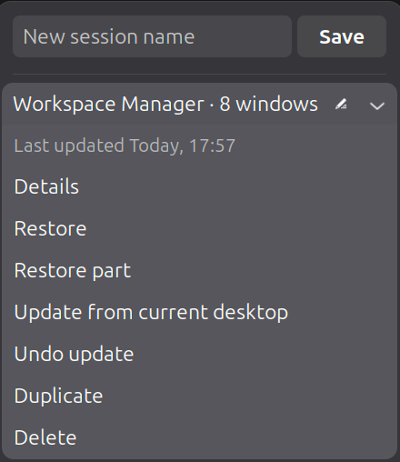
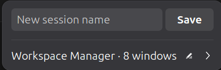
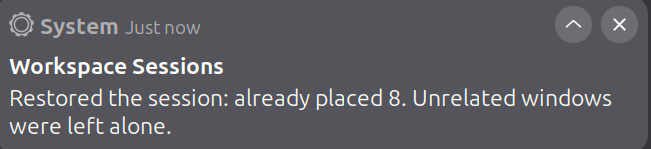

# Workspace Sessions

Save the desktops you actually use, then bring one back without closing everything else.

Workspace Sessions is a GNOME Shell extension. It stores named sessions on this computer and restores them when you ask. A restore moves windows that are already open and opens only what is missing. It never closes a window just because that window was not part of the saved session, and it does not restore anything at login.

Copyright (C) 2026 Neelansh Gupta. Licensed under the GNU General Public License, version 2 or later. See [LICENSE](LICENSE).

## Screenshots







## Requirements

- GNOME Shell 50 on Wayland. This package was developed on GNOME Shell 50.1.
- No other extension is required.

## Install

From a clone of this repository:

```sh
mkdir -p ~/.local/share/gnome-shell/extensions
ln -s "$PWD/extension" ~/.local/share/gnome-shell/extensions/workspace-session-manager@gmail.com
```

Log out and back in, then enable **Workspace Sessions** in the Extensions app, or run:

```sh
gnome-extensions enable workspace-session-manager@gmail.com
```

The extension id is `workspace-session-manager@gmail.com`. The directory name under `~/.local/share/gnome-shell/extensions/` has to be that id.

JavaScript changes are not picked up by a running Shell. Log out and back in after changing the code or replacing the install.

To build the zip used by the GNOME Extensions website:

```sh
mkdir -p dist
gnome-extensions pack extension \
  --extra-source=core \
  --extra-source=gnome \
  --extra-source=integrations \
  --extra-source=ui \
  --extra-source=icons \
  --out-dir=dist \
  --force
```

## Use

Open the panel menu.

- **Save** stores the current desktop under the name you type.
- **Details** lists the windows in a session and what a restore will move or open.
- **Restore** merges that session into the current desktop.
- **Restore part** restores one workspace, or the windows you leave selected.
- **Update from current desktop** replaces the saved windows with what is open now.
- **Undo update** puts back the previous capture. Only the latest update is kept.
- **Duplicate** copies a session. **Delete** removes it after a second click.

While a restore is running, the menu shows what it is opening and a **Cancel** item.

Sessions are stored in `~/.local/share/workspace-sessions/`. Session files and the recovery file are readable only by your user.

## What a session can restore

Every normal window is saved with its application, title, workspace, and monitor. When the application exposes more, the session also keeps:

| Application | What is restored |
| --- | --- |
| Brave, Chrome, Chromium, Edge, Vivaldi | Profile and tabs |
| Firefox | Profile and tabs |
| Visual Studio Code, Insiders, VSCodium, Code - OSS, Cursor | Project folder |
| Files, Nemo, Thunar, Dolphin | Folder, when its name identifies one directory |
| Ptyxis | Working directories |
| Text Editor, gedit, Papers, Evince, LibreOffice Writer, Calc, Impress, Draw | The document, when its name identifies one recent file |

Other applications are restored as windows: the right application on the right workspace, without an extra document or tab.

## Crash recovery

The extension writes one recovery snapshot after the desktop has been still for a minute. It is not a continuous autosave, and it is not a named session.

On the next login, if that snapshot exists and the Shell did not close cleanly, a dialog offers to restore it. **Not now** leaves the offer in the menu. **Discard** drops it. A completed restore also drops it. A normal logout writes a clean shutdown and does not ask.

Logging in never restores a named session by itself.

## Limitations

- Supported Shell version is 50 only.
- Restore is manual. There is no restore-on-login setting.
- Unrelated windows are left alone, including windows you opened after the save.
- A missing document, folder, or project is skipped. The extension does not open a different file in its place.
- Two documents or folders with the same name are left unresolved.
- A window saved on a monitor that is no longer connected is placed on the primary monitor.
- Pixel position and size are best-effort. Edge tiling from other tools is not restored as a tile layout.
- Terminal directories are saved for Ptyxis. Other terminals come back as ordinary windows.
- Browser passwords, cookies, and history databases are not read. Shell commands are not stored in a session and are not run from one.
- Unsaved editor buffers are not part of a session.
- The recovery snapshot can lag behind the last minute of work, because it is written only after the desktop has been still.

## Development

Tests use GJS and do not start GNOME Shell:

```sh
gjs -m tests/test-model.js
gjs -m tests/test-matching.js
gjs -m tests/test-browser.js
gjs -m tests/test-vscode.js
gjs -m tests/test-contexts.js
gjs -m tests/test-documents.js
gjs -m tests/test-recovery.js
```

`docs/feasibility.md` is the original API research for GNOME Shell 50.1. This README describes the extension as it is now.

## Source

https://github.com/neelansh-gupta/workspace.session.manager
